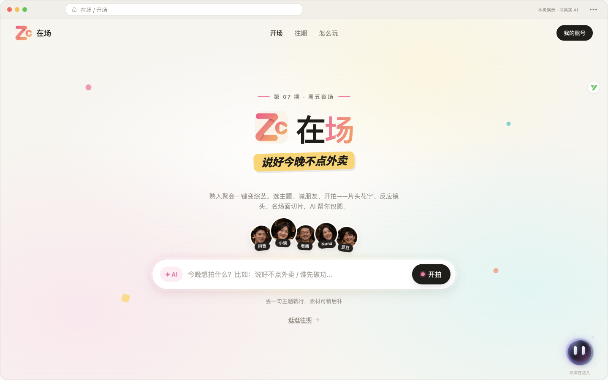

# 在场 · 把熟人聚会拍成综艺

上传聚会片段，和 AI 导演聊想法，选择拍法，再预览、校对和导出一段属于自己的节目。

**当前状态：开源开发版，完整前后端可在本机运行。尚未提供公共后端或在线体验服务。**



## 做什么

- **导演对话**：悬浮导演支持文字交流及短语音转文字，结合本期素材、拍法和检查报告提出建议。
- **从素材到初稿**：视频上传、画面分析、原声转写、内容核对、拍法选择与原声初稿制作。
- **综艺包装**：字幕、花字、贴纸、局部强调、转场与旁白；具体效果受素材与已实现的渲染能力限制。
- **可控制的制作**：本机导演委托支持暂停、继续、结束与有限重试，任务持久化，完成后停在未确认候选。
- **预览与校对**：原片弹窗回看、竖屏适配、字幕修改和隐藏、版本保留、确认后导出。
- **朋友参与**：供材、采访表达确认、私密分享与撤回的本机流程。

这不是全自主剪辑系统。当前采用一个面向用户的导演对话入口，加上受控的素材、编导、语音和渲染工作流。自动检查包含播放/音轨、字幕与选段时间规则、抽样画面；完整连续视听理解、自主内容返工与综艺效果评测仍在完善。

## 先在本机试用（无需模型密钥）

需要 Python 3.12、Node.js 22 或更新版本、FFmpeg/ffprobe；中文包装还需要可用的中文字体。macOS 可通过 Homebrew 安装 FFmpeg，Linux 可使用发行版的软件包管理器安装 FFmpeg 和 Noto CJK 字体。

克隆后，在仓库根目录安装依赖：

```bash
cd 'projects/我们的这一期/backend'
python3.12 -m venv .venv
.venv/bin/python -m pip install -r requirements.txt
cd ../frontend
npm ci
npm run build
```

回到仓库根目录，分别打开两个终端：

```bash
# 终端一：本机演示后端
bash 'projects/我们的这一期/scripts/run-demo.sh'
```

```bash
# 终端二：演示网页
bash 'projects/我们的这一期/scripts/run-web.sh' demo
```

打开 **http://127.0.0.1:3001**，本机演示登录码为 **demo**。

演示模式使用固定模型结果和合成提示音，不调用付费模型，不代表真实 AI 输出质量。仓库不附用户视频，运行后可用自己的授权素材试走流程。本机演示服务只监听回环地址，不能直接作为公共服务部署。

## 真实模型与后端

| 环节 | 当前适配 |
| --- | --- |
| 画面与编导、导演对话 | DeepSeek 适配器 |
| 原声转写 | MiniMax ASR |
| 旁白 | MiniMax Speech |
| 裁切、拼接、字幕与包装 | 本机 FFmpeg / Pillow |
| 可选人脸几何定位 | Apple Vision / MediaPipe；不做身份识别 |

模型通过服务端适配器接入，接口和模型名以代码及供应商当前可用配置为准。`backend/.env.example` 只包含空密钥和关闭状态；真实调用还需要明确素材授权、数据处理范围和预算，填入 Key 本身不会绕过准入检查。仓库中的专项测试工具用于开发者已授权的测试范围，不携带其授权文件。

普通服务启动配置见 [开发运行说明](projects/我们的这一期/README.md)。**不要把密钥放进前端，不要把本机邀请码、数据库或视频发布到 GitHub。**

GitHub Pages 只能提供静态网页，无法承载本项目的 FastAPI、持久任务与 FFmpeg 后端，因此本仓库目前仅提供源码和本机试用说明。公共演示需要独立部署、访问隔离、配额和素材管理，尚未开通。

## 架构与目录

```text
Next.js / React 网页
  → 同源 API 代理
  → FastAPI：会话、归属、确认点与预算
  → 持久任务：分析 → 编导 → 渲染 → 检查 → 用户确认
  → SQLite + 本机媒体目录
```

代码保留早期目录名 `projects/我们的这一期/`，产品显示名称已改为「在场」。

- `backend/app/`：接口、任务、模型适配、权限和渲染。
- `frontend/src/`：开场页、制作流程、悬浮导演和参与者页面。
- `scripts/`：启动、演示、验证与受控测试工具。
- `docs/`：早期开发文档和当前公开说明；历史记录不代表当前质量结论。

## 验证状态

2026-11-16 本机完整检查：**1227 项后端测试、387 项前端测试通过**，类型检查、Lint、生产构建、密钥排除和重启恢复通过。真实模型接口已做受限素材验证；这不等于所有内容质量通过，也不等于公共服务已上线。

```bash
cd 'projects/我们的这一期/backend'
.venv/bin/python -m pytest -q
cd ../frontend
npm test
npm run typecheck
npm run lint
npm run build
```

## 开源与素材许可

代码沿用 [MIT License](LICENSE)，保留开发工具包原版权声明。字体、参考实现和历史演示影片截图分别遵循其原始许可，见 [第三方素材说明](projects/我们的这一期/docs/第三方素材说明.md)。

本次公开更新包含应用代码、测试、必要资产和公开说明；不包含用户真人测试视频、当前真人测试截图、数据库、密钥、私有授权文件或模拟简历材料。首页头像为生成的虚构角色，首页截图不包含用户上传素材。
