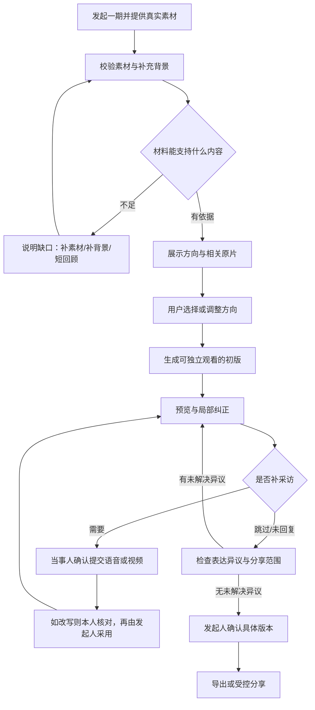

# PRD —— 我们的这一期

| 项 | 内容 |
|---|---|
| 产品名 | 我们的这一期 |
| 当前版本 | V1 |
| 状态 | 研发评审草案，未冻结 |
| 本稿整理日期 | 2026-11-06（Asia/Shanghai） |
| 执行方式 | 当前 AI 按手册分析，未运行模型管线；组件规则已实际执行 |
| 交付范围 | PRD 与研发评审方案；本轮不生成产品代码 |
| 工作区 | `out/我们的这一期/`：PRD、方案、骨架（skeleton/）、验证报告、迭代记录都在这里，不要写到别处 |
| 迭代方式 | 新需求 → `blueprint revise` 升版 PRD → 重推方案 → 增量更新 skeleton/ → `blueprint verify` → 人工验证 → 下一轮 |

## 版本演进记录

| 版本 | 日期 | 变更 | 来源 |
|---|---|---|---|
| V1 | 2026-11-05 | 按工坊初始化记录建立工作区并导入原始方案 | S1 |
| V1 | 2026-11-06 | 结合获授权的用户需求文档完成初稿整理；同一初始版本内修订 | S1、S2 与本轮用户答复 |

## 1. 原始需求（逐字保留，不改写）

完整原方案同时保存在 `materials/`。下方折叠区保留原文；研发评审正文从第 2 节开始。输入方案的 v0.1 与本工作区 PRD 的 V1 是不同版本体系。

展开原始产品方案全文

# 我们的这一期｜产品方案 v0\.1（共创草案）

更新日期：2026 年 11 月 5 日。文档阶段：产品概念与体验方案，尚未进入研发定版。

本文用于共同确定产品做什么、服务谁、核心体验如何成立，以及第一版应包含哪些能力。用户需求文档随后补充需求证据、具体任务与优先级；竞品分析文档随后补充实际体验、功能对照与差异判断。

# 产品概述

**AI 导演根据朋友聚会的真实素材提出节目方向，用户参与选择，剪成一期热闹的综艺短片，再用真实采访补上另一面。**

产品暂定名为“我们的这一期”。用户上传做饭、生日、周末相聚等活动的视频，AI 以综艺导演组的方式组织故事，通过花字、旁白、回放和音效制造节目感。看过初版后，当事人可以补充一句解释或一段采访，让同一件小事出现新的视角。

产品希望带来的感受是“这件事真的发生过，而且这节目很像我们”。成片先服务于参与活动的熟人，供大家一起看、讨论和保存；用户认为合适时，再自行分享至公开平台。

本方案中的产品能力和体验均为拟实现设计。需求强度、自动成片质量、用户使用频率和商业可行性仍需验证。

# 已确定的产品方向

|议题|本轮共识|
|---|---|
|优先场景|熟人小圈子的日常聚会，包含一起做饭、生日和周末相聚。|
|核心创意|将普通小事拍出隆重、热闹的综艺效果，并通过当事人的真实事后采访补充不同视角。|
|节目风格|热闹的综艺导演组，采用画外音，配合花字与互动，真人画面为主体。具体声线与视觉样式继续共创。|
|分享顺序|熟人分享优先；有机会或大家喜欢时，再由用户决定是否放到公开平台。|
|真实观感|优先使用真实拍摄、本人原声和本人提供的采访。采访支持本人语音和补录片段，AI 包装围绕实际发生的事情展开。|
|后续探索|拍摄引导可在核心体验成立后加入。缺少真实影像的动画回忆重演留到后续版本另行讨论。|

# 目标用户与需求假设

## 优先服务的人

目标是会一起活动、愿意记录彼此的熟人小圈子。圈子里通常需要有人愿意收集素材、发起制作并把成片分享给大家。这里的角色划分是产品设计假设，尚无访谈结果支持其普遍性。

- **制作发起人。**拥有聚会素材，想做一条大家愿意看的短片，希望少做剪辑操作，同时能纠正 AI 的理解。

- **出镜参与者。**关心自己被怎样呈现，愿意在有趣的片段上补一句解释、吐槽或回忆。

- **熟人观众。**包括参与活动的人和熟悉这群朋友的人，关注人物之间的互动，也可能补充遗漏的素材或背景。

原方案以 18～30 岁年轻人为主用户。当前先以行为与场景界定用户，年龄范围留给后续需求研究验证。专业内容团队和机构级综艺制作不作为第一版的主要服务对象。

## 需要验证的问题

- 聚会后，用户是否有足够的真实视频，也有把素材整理给朋友看的意愿。

- 制作的主要困难是否包含挑选有趣片段、补足上下文和形成故事，用户愿意为此做多少补充。

- 参与者是否愿意在看过初版后补一句采访，这句话是否确实提高成片的趣味和可理解性。

- 热闹的综艺包装能否让大家更愿意观看和分享，以及何时会显得吵闹、冒犯或失真。

上述内容作为用户需求文档的研究起点，不写成已经证实的用户结论。

# 核心体验设计

## 把小事认真地拍成一期节目

一期节目围绕素材中能够成立的一件事展开。例如做一顿饭、准备生日惊喜，或大家为一个小决定争论许久。AI 从真实行动、对话和结果中提出本期主题，组织必要的前后关系，再加入节目包装。

建议的叙事结构是有趣的开场、必要的背景、事情发生变化、真实结果和片尾彩蛋。素材不支持完整结构时，应缩短内容或采用片段回顾，不强行补出冲突、反转和结尾。

导演组可以对实际场面进行夸张而友善的评论，使用任务提示、定格花字、重点回放和声音停顿等手法。具体说了什么、谁做了什么，以及反应属于哪个时刻，应保留原有含义。

## 看过节目，再补上自己的视角

初版先帮助参与者回到具体场景。AI 在适合的位置给出一个采访问题，例如“当时为什么一直站在旁边？”或“你那会儿知道他已经准备好礼物了吗？”。当事人可以回答、修改问题，也可以跳过。

采访来自当事人主动提供的内容。AI 可以帮助缩短表达和安排剪入位置；涉及改写时保留原意并供本人确认，不替当事人编写内心想法。

事后采访在画面中以明确的采访形式呈现。不同人的记忆有分歧时，可以保留各自署名的说法，不自动判定某一方说的就是事实，也不把采访剪成当时现场说过的话。

## 让热闹围绕真人展开

节目主风格采用热闹的综艺导演组。花字强调当下的动作和反差，互动邀请当事人回应，音效和回放服务于具体笑点。

当真人对话、表情或现场声音已经足够有趣时，导演组适当退出。提供减少旁白、减少花字和降低吐槽力度的调整入口，便于用户修正某一段的表达。

人设表达优先描述“本期做了什么”，避免把一次行为固定成对一个人的长期评价。导演组采用画外音，配合花字和互动问题，第一版不安排可见的虚拟主持人出镜。

# 用户体验流程

建议流程为：一人提供或多人汇集素材 → AI 导演提出节目方向 → 用户在引导下选择 → 生成初版 → 查看并纠正、可选补采访 → 生成更新版 → 熟人分享 → 用户自行决定是否公开。

## 发起一期节目

发起人选择同一次聚会的视频，可以补充活动名称、人物称呼和一句必要背景。人物称呼采用用户提供的信息；AI 无法确认时允许留空，不推测人物之间的关系。

第一版以视频为主要输入，同时覆盖一人提供主要素材和几位朋友共同补充素材两种情况。由发起人组织同一期节目，具体邀请与汇集方式待设计。原方案的 3～8 段、总计不超过约 10 分钟，暂作为样片试验的输入参考，不作为已经确定的产品限制。

## 看到可以独立观看的初版

AI 导演先根据已有素材提出可成立的节目方向，用简短说明和相关原片帮助用户理解各自会讲什么。用户可以选择、提出调整或让 AI 再给方向，然后生成初版。具体选项数量待原型验证，不要求用户预先写脚本。用户能够了解当前处理阶段；等待时间需验证后再承诺。

初版应包含可理解的内容顺序和适量包装。没有采访时也能观看和导出，不把所有朋友完成回答作为出片条件。建议先以原方案的 60～90 秒作为样片参考，最终时长随故事完整性调整。

## 用直接的反馈修正内容

用户可在片段上提出“这段必须保留”“这句理解错了”“这段别用”“换一个重点”等修改，也能编辑标题、花字和旁白，或降低某一段的包装强度。

对涉及人物、原话和反应的片段，应能够回看相应原片。修改后先预览受影响的内容，保留此前可用版本，避免一次修改让用户失去已接受的结果。

## 可选补充采访

发起人可以回答自己的采访，也可以邀请当事人为一个具体片段补充内容。朋友可以只回答自己收到的问题；未回答、拒绝或中途退出时，现有节目仍可使用。

采访支持本人语音和补录片段，补录内容以事后采访或补充说明呈现。朋友通过链接还是进入产品回复，以及具体提交方式，继续共创确认。

朋友在提交前确认自己的内容。采访送回后，发起人预览加入采访的新版本，再决定使用或调整。采访来源与原始内容应可核对。

## 分享与保存

发起人完成预览后，可导出成片或通过可控范围的链接分享给熟人。熟人观看不自动等于进入公开内容池，朋友收到采访邀请也不默认获得全部原始素材。

公开分享由用户主动决定。若需要面向不熟悉这群人的观众，可以补充必要背景，并移除仅适合群内的内容。第一版不自动发布到外部平台，也不要求接入公开推荐信息流。

链接的访问方式、有效期和关闭方式，以及原始素材的保存期限，需要在产品载体确定后形成具体规则。

# 一集节目的概念样例

**以下是用于讨论体验的虚构样例，不是用户访谈、真实案例或已生成的样片。**

场景为几个朋友周末一起做饭。假设真实素材包含开工时的豪言、手忙脚乱的准备过程，以及最后外卖到达、大家一起开饭的画面。

本期标题暂拟《说好今晚不点外卖》。开场先给到外卖袋，随即明确回到开工时，播放当事人的原话。中间围绕实际发生的忙乱展开，花字如“主厨正在紧急进修”，旁白和音效在原声间隙出现。最后以大家一起吃饭收尾。

初版播到某个人默默看手机的片段时，导演组邀请本人回答“这会儿你在查菜谱，还是准备找外援？”。如果本人真实回复“我在看外卖多久能到”，这句话就能作为事后采访加入。没有这句回答时，不自行编造相同的想法。

这个样例需要验证的体验是：同一批真实片段能否形成一个完整的小故事；热闹包装是否恰到好处；真实采访是否让原片多出一个有趣视角。

# 第一版范围建议

以下为本次初稿提出的范围建议，尚未形成研发承诺。优先把“一人发起、完成一期、可补真实采访、分享给熟人”的过程做好。

|能力|首版建议|希望观察到的结果|
|---|---|---|
|素材输入|支持一人提供或多人补充同一次聚会的视频，可补充称呼与必要背景。|一位发起人可以开始，也可接收朋友补充的素材。|
|故事组织|AI 导演从素材提出方向，引导用户选择本期主题与重点，再组织片段生成初版。|观众能说明这一期发生了什么。|
|综艺包装|一种热闹导演组风格，包含花字、旁白、音效及适量回放，支持减弱。|包装突出真人互动，关键原声仍可听清。|
|真实采访|围绕片段提问，支持本人语音和补录片段，允许跳过或邀请当事人补充。|采访能补足视角，未回答不阻断出片。|
|预览与修改|编辑文案、保留或删除片段、纠正理解和调整包装；可以回看原片。|用户能修正影响分享意愿的问题。|
|导出与分享|确认后导出，或分享可控范围的链接；具体链接方式随载体确定。|熟人能看到成片，公开发布由用户决定。|

第一版暂不纳入换脸、声纹仿冒、自动编造真人剧情、完整时间线专业剪辑、多种节目类型、公开社区与自动平台发布。动画回忆重演留到后续版本；导演组采用画外音。支持几位朋友为同一期补充素材；复杂的多人共同编辑和多主角版本暂不纳入基础范围。

# 真实感与失败处理

## 内容边界

- **事实与语境。**不替当事人编话、编动作或编心理。预告、回溯和事后采访应让观众看得出时间关系，不用不相关的表情制造虚假的现场反应。

- **玩笑分寸。**围绕可观察的小事和反差进行轻吐槽，不用外貌、身份或羞辱性标签制造笑点。用户可以删除、改写或减弱表达。

- **本人表达。**采访保留来源与归属，不模仿好友声纹。不同人的说法可并存，AI 不擅自代替当事人达成一致。

- **可控分享。**原始素材、采访内容和成片分别设置可见范围；允许用户取消分享链接。具体规则在载体确定后补齐。

- **生成内容说明。**成片需让用户和观众了解其中包含 AI 编排、旁白或花字；具体呈现方式在发布设计时核实。

## 素材或生成结果不理想时

|情况|建议处理|
|---|---|
|素材不足，缺少起因或结果|指出缺的是什么，让用户补一句背景、补片段，或选择更短的回顾。保留已有成果。|
|多人同时讲话或原声听不清|不把不确定的转写当作原话；允许用户校正字幕，也可跳过该段的语义包装。|
|人物或笑点理解有误|回看原片，修改称呼、背景或解释，并只更新相应内容。|
|采访无人回答|初版继续可看、可导出。用户可以跳过，不反复催促朋友。|
|包装太密、吐槽不合适|按片段减少旁白、花字或音效，替换文案，允许整段删除。|
|上传或生成中断|保留已接收的素材和已确认的编辑，告知可重试的阶段，不要求无依据地重复整套流程。|

# 差异化设想与后续版本

本产品拟验证的差异集中在三个相互连接的环节：围绕熟人互动组织一期故事、形成有辨识度的热闹导演组表达，以及让真实事后采访继续改变节目。它们目前是产品主张，需要通过同素材对比和真实使用验证，不能据此声称其他产品都不具备相关能力。

核心体验成立后，可以逐步探索以下方向，先后顺序根据用户反馈调整。

- **拍摄辅助。**下一次聚会前提示拍开场预测、过程反应和结束感想，帮助用户得到更适合剪辑的素材；参与者可自由跳过。

- **我们的这一季。**同一群朋友保存节目名称、期数和经确认的共同梗，形成连续记录。记忆内容由用户主动保存和管理。

- **更多观察视角。**同一期加入更多当事人的采访，或尝试围绕不同主角重新组织内容。

- **面向公开观众的版本。**补足圈外人理解故事所需的背景，提供适合公开分享的编辑方式。

- **回忆重演。**将缺少真实影像的共同回忆用动画等形式呈现。用户已明确后置，后续需单独验证真实观感与接受度。

# 验证方式与成本关注点

下一步先制作概念样片，验证核心体验，再确定研发范围。建议使用自然拍下的聚会素材，同时包含普通、嘈杂和碎片化内容，避免只用适合讲故事的素材判断产品表现。

第一轮用同一批素材比较普通回顾与综艺版本；第二轮在同一综艺版本上加入真实采访，观察采访单独带来的变化。除了制作发起人，也邀请出镜参与者观看，记录他们愿意保留或分享的版本，以及需要纠正的具体地方。

- 能否讲清楚这一期发生了什么，哪些片段被认为有趣或被误解。

- 成片是否实际分享给熟人，分享前需要多少次纠正，以及用户投入多少时间。

- 采访问题是否容易回答，多少人实际回答，加入后是否被保留。

- 用户有下一次适合的活动素材时，是否再次选择制作。

- 从上传到可接受成片的等待时间，以及包含失败、重生成和修改在内的处理成本。

现阶段不设未经验证的转化率或留存门槛，也不固定开发排期。原方案中的小样本比例、周留存目标和四周作品集安排，不作为本次产品方案的已确认承诺。

费用方案尚未确定。可以在需求和使用频率更清楚后比较按期购买、活动包与会员；当前先了解每条被用户接受的作品需要多少处理与修改，避免按一次生成的成本判断整个服务。

# 下一轮需要共同决定的事项

已确定的场景、分享顺序和节目主口气见本文第二节。以下问题尚不妨碍讨论产品价值，但会影响下一版方案和后续原型。

|未定事项|当前建议或候选|需要决定的原因|
|---|---|---|
|采访接收方式|本人语音和补录片段已确认；回复入口、补录提示和提交确认方式待定。|影响真实观感、参与门槛与剪入方式。|
|画外音细节|已确认采用画外音；具体声线、表达细节及与现场原声的配合方式待定。|影响节目辨识度、真人画面占比和制作成本。|
|产品载体|小程序、移动网页、独立 App 均未定。先用样片检验内容体验。|影响上传、邀请朋友、访问权限和成片分享。|
|制作与协作|已确认覆盖一人提供与多人汇集素材，采用 AI 导演引导用户选择。具体汇集入口、内容确认与协作权限待定。|影响第一版能否顺利完成，以及人物确认方式。|
|成片规格|时长、横竖屏、输入上限与清晰度待样片试验后确认。|需要平衡观看场景、故事完整性和处理成本。|
|保存与收费|素材期限、删除方式、免费额度和付费方案均未定。|需结合载体、成本和真实使用频率确定。|

# 依据与后续文档衔接

本稿依据[《AI 自制综艺 · 产品方案（融合版）》正文](https://my.feishu.cn/wiki/Nu37w1vhRixV0akloTjc7QlOnLd)及本次共创讨论编写。原文档内嵌的 AI 能力与竞品差异表尚未读取，本稿不把其内容作为依据。

本轮用户已确认优先做“把普通生活拍成热闹综艺”与“真实事后采访”两个方向；拍摄引导可后续加入，回忆重演后置。随后确认日常聚会优先、熟人分享优先，以及热闹导演组的节目口气。本轮进一步确认采访支持本人语音和补录片段，导演组采用画外音；素材需兼顾一人提供与多人汇集，创作方式采用 AI 导演给方向、用户参与选择。

[《我们的这一期｜用户需求文档 v0\.1（共创与验证版）》](https://my.feishu.cn/docx/FChkdgKihoVfEwxqUlGcjLEYnSh)已形成初稿，包含用户任务、需求优先级、成功表现和验证计划，后续补充访谈与素材观察证据。竞品分析文档将单独记录产品版本、实际体验过程、同素材结果和证据。两份文档的发现将用于修订本方案。

## 2. 需求拆解

### 2.1 文档用途与结论状态

本稿用于研发评审，帮助产品、设计与研发讨论范围、交互、状态、依赖和验收。当前没有真实样片、终端用户研究、原型测试或技术性能测试结果；本文不代表需求冻结、工期承诺或功能已经实现。

| 标记 | 本稿含义 |
|---|---|
| 已确认方向 | 两份输入材料记录的产品发起人取舍，可以作为本次设计前提 |
| 候选需求 | 从方案与用户任务细化的首版功能，需在研发评审中确认范围 |
| 设计建议 | 为使流程可执行而提出的规则或数据结构，尚未由用户逐项确认 |
| 待确认 | 会改变交互、实现、成本或发布条件的决定，列在第 6 节 |
| 待验证假设 | 关于真实用户行为、效果或性能的判断，不能作为研究事实 |

下面 FR、AC、状态机和权限表均是候选规格。没有单独标为已确认的细节，不因使用“应”或“必须”就变为研发承诺。P0/P1/P2 代表建议评审优先级，不代表已估算工作量或确定发布排期。

### 2.2 来源与可继承决定

| 来源 | 内容与使用方式 |
|---|---|
| S1 | [产品方案 v0.1 原件副本](materials/我们的这一期｜产品方案%20v0.1（共创草案）.md)。本次指定的主输入，保留原文与证据状态 |
| S2 | [用户需求文档 v0.1 快照](materials/用户需求文档-v0.1-飞书修订4.md)。经用户授权只读获取，飞书 revision 4，沿用 D1～D7 和 U01～U12 |
| S3 | 本轮用户要求“研发评审，尽量细化功能与验收要求”；本轮授权导入材料、建立工作区和输出 PRD |
| 方法 | 工坊 `BLUEPRINT.md` 的需求拆解、领域建模、组件选型与架构设计；技术补充见 [方案.md](方案.md) |

| 已确认编号 | 可继承的产品方向 | 不应据此推导的结论 |
|---|---|---|
| D1 | 熟人小圈子的日常聚会，优先做饭、生日、周末相聚 | 不固定年龄、职业和活动频率 |
| D2 | 真实素材做热闹综艺，真实事后采访补充视角 | 不允许编造当事人的话、行为或内心；不能认定体验已验证 |
| D3 | 熟人分享优先，公开发布由用户决定 | 熟人观看或接受采访不等于同意公开传播 |
| D4 | 热闹导演组、花字与互动、画外音、真人为主 | 不引入可见虚拟主持人；声线和包装样式未定 |
| D5 | 采访支持本人语音和本人补录视频 | 入口、身份核验和采访处理细节未定 |
| D6 | 一人持有主要素材或几位朋友共同供材均需覆盖 | 不意味着多人共同编辑，也不证明市场中的素材分布比例 |
| D7 | AI 根据素材提出方向，用户在引导下选择 | 不能要求用户先写脚本；方向数量不固定 |

### 2.3 工坊六项需求事实

| 维度 | 本项目定义 | 确定程度 |
|---|---|---|
| 目标 | 让发起人将一次真实聚会整理成当事人认可、熟人能看懂的综艺短片，并可用真实采访补充视角 | 产品目标已明确；需求强度和体验效果待验证 |
| 用户 | 发起人、素材贡献者、出镜与采访参与者、熟人观众；同一人可有多个角色 | 角色是设计划分，尚无真实画像证据 |
| 核心闭环 | 收集素材与必要背景 → 素材分析 → 有依据的方向提案 → 用户选择 → 可独立观看初版 → 修改或可选采访 → 用户认可版本 → 导出或受控分享 | 已有流程方向；具体入口和规则为本稿候选规格 |
| 交付物 | 可播放的综艺短片、制作中可核对的来源与版本、导出文件或受控观看入口 | 格式、画幅、时长、清晰度待定 |
| 边界 | 真实素材与语境、可纠错、原片/采访/成片分别授权、采访不强制、外部发布不自动执行 | 来自 S1 与 S2；权限细则仍需评审 |
| 约束 | 载体、素材容量、处理时延、并发、单期成本、保留期限、身份方式、模型服务均未确定 | 不填虚构目标值；评审依赖见第 6 节 |

### 2.4 用户任务与候选范围

| 需求 | 候选本期处理 | 对应功能 |
|---|---|---|
| U01 组织同一期素材 | 一人能够开始；朋友可补充；发起人看清收到、失败和未采用的内容 | FR01、FR02 |
| U02 在引导下选择 | 用真实片段解释方向差异；支持补背景、换重点和重提 | FR03 |
| U03 真实且有节目感的故事 | 可理解的片段顺序与适量包装；保留关键原声 | FR02、FR04 |
| U04 纠正并保留喜欢部分 | 针对片段修改，预览影响，保留已认可版本 | FR05、FR13 |
| U05 补真实个人视角 | 本人语音/补录视频；理解问题后自愿提交 | FR06、FR07 |
| U06 核对呈现并提出调整 | 有明确的异议入口和处理结果；不能只让发起人忽略异议 | FR08 |
| U07 自主协作节奏 | 未上传、未回复可继续；迟到内容由发起人选择是否更新 | FR01、FR06、FR07、FR08 |
| U08 分享并理解可见范围 | 区分导出、产品内分享与外部副本；允许关闭产品内链接 | FR10、FR11 |
| U09 中断后继续 | 保存已完成素材、已选方向和已确认编辑；从失败阶段恢复 | FR09、FR13 |
| U10 找回历史作品 | 当前一期恢复和版本查看先由 FR13 覆盖；跨活动作品列表列 P1，是否同批发布待确认 | FR14 |
| U11 公开观众版 | P2，独立的公开版改编流程后置；本期允许用户自行导出后决定公开 | 不自动增加公开社区、信息流或外部发布接口 |
| U12 下一次拍摄辅助 | P2，完成当前体验验证后单独评审 | 不纳入本期拍摄引导能力 |

本期候选目标是完成“一人发起、朋友可供材、用户选方向、初版可用、可修改、可选真实采访、熟人分享”的闭环。语音与视频采访均来自已确认方向；若需分批交付，应由用户明确调整范围，不能在估算时悄悄删去一种。

本期不纳入换脸、声纹仿冒、真人虚构剧情、专业时间线剪辑器、多种节目类型、多人共同编辑、多主角自动成片、可见虚拟主持人、公开推荐社区、自动平台发布。拍摄引导、共同梗长期记忆、动画回忆重演为后续探索，不预设日期。

原文的“3～8 段、约 10 分钟输入、60～90 秒成片”仅为样片参考；18～30 岁也不是当前确定画像。本稿不将它们作为上传校验、时长限制或招募硬条件。

### 2.5 主流程与分支

“无未解决异议”不等于“所有人必须逐一审批”。不自动把朋友未回复当作已同意公开；具体授权机制在 Q03 中确认。没有采访仍能出片，但有明确异议的内容应先解决或移除。

## 3. 功能需求

### 3.1 功能索引

| ID | 功能 | 建议优先级 | 来源 |
|---|---|---|---|
| FR01 | 创建一期与素材汇集 | P0 | S1 发起一期；S2 U01、U07 |
| FR02 | 素材分析、称呼与来源核对 | P0 | S1 真实感；S2 U02、U03、U06 |
| FR03 | 导演方向提案与确认 | P0 | D7；S2 U02 |
| FR04 | 初版与综艺包装 | P0 | D2、D4；S2 U03 |
| FR05 | 片段反馈与局部修改 | P0 | S1 用直接反馈修正；S2 U04 |
| FR06 | 采访邀请与本人提交 | P0 | D5；S2 U05、U07 |
| FR07 | 采访核对、采用与更新版 | P0 | S1 可选采访；S2 U05、U06 |
| FR08 | 表达异议与撤回处理 | P0 | S2 U06、U07、U08 |
| FR09 | 任务进度、中断与重试 | P0 | S1 失败处理；S2 U09 |
| FR10 | 预览确认与导出 | P0 | S1 分享保存；S2 U03、U08 |
| FR11 | 受控观看与关闭分享 | P0 | D3；S2 U08 |
| FR12 | 保存期限与删除边界 | P0 规则待定 | S1 保存与收费；S2 U08、开放问题 |
| FR13 | 制作中版本与恢复 | P0 | S1 修改保留旧版；S2 U04、U09 |
| FR14 | 跨活动找回作品 | P1 待范围确认 | S2 U10 |

### 3.2 逐项功能规则

#### FR01 创建一期与素材汇集

发起人创建一期，可补活动名称、称呼和必要背景，然后选择本次愿意提供的视频。只选择具体文件，不要求开放整个相册。朋友补充的原始现场视频进入同一期；与事后采访视频分开标记。

素材清单至少能区分待传、上传中、已接收、不可处理、未采用。显示文件和贡献来源，让发起人判断何时继续；未参与或上传失败的朋友不锁住已可用素材。若当前无可用内容，说明原因并提供补充入口，不生成虚假的“初版成功”。

设计建议：补充入口只授予向指定一期提交素材的能力，是否可查看自己提交记录按 Q02 确认；不因提交而开放全部原片。重复提交同一操作不能产生无意重复资产，内容相同但意图不同的提交应提示用户选择，而非静默删去。

依赖 Q01、Q02、Q04；验收 AC01、AC02、AC03。

#### FR02 素材分析、称呼与来源核对

分析形成可追溯的镜头、声音、转写与事件线索。涉及原话、动作、人物或反应的内容，应能定位到原片及时间区间。用户能够核对并修正称呼、背景、字幕与片段解释。

人物称呼来自用户提供或确认的信息；不推测朋友关系。听不清的部分保留不确定性，不把模型猜测渲染成确定原话。无法判断的笑点不影响做较短回顾。来源类别区分现场音视频、用户背景说明、事后采访与 AI 包装。

技术建议是按需读取素材索引，不让全量原片或转写无条件进入每一次模型请求。技术能力、媒体格式和内容识别质量要用实际样本验证。

依赖 Q04、Q09；验收 AC04、AC05。

#### FR03 导演方向提案与确认

方向提案需说明“这一期主要讲什么、重点在哪里、哪些原片支持”。用户可以接受、补背景、换重点或重新提案。只有一个方向有依据时可只展示一个；没有依据时回到补材料或短回顾，不为凑选项制造事件。

生成初版前保存用户选中的方向及对应素材版本。补充背景是用户陈述；若与原片存在矛盾，提示核对，不自动把新说法写成原片事实。切换方向应说明可能影响哪些已确认内容，保留旧版本。

方向选项数、交互轮次、是否附片段预览的具体布局按 Q05 验证。验收 AC06、AC07。

#### FR04 初版与综艺包装

初版包含能够理解的顺序和适量节目包装。可采用有趣开场、背景、过程变化、真实结果与彩蛋；素材不支持时可缩短或采用片段回顾，不强行填齐叙事结构。

真人画面、本人原声是主体；画外音、花字、音效和回放围绕已发生的事情展开。关键原声不得因包装而难以理解；确实需要旁白时安排在不损害主要表达的位置。提供减弱包装的控制能力，精确声线、音效素材和视觉模板在 Q05 确认。

初版不依赖采访完成。渲染输出应区分“技术生成成功”与“用户认可可分享”；可播放文件本身不能证明有趣、真实或符合本期方向。

依赖 Q04、Q05、Q09、Q10；验收 AC08、AC09、AC10。

#### FR05 片段反馈与局部修改

用户可标记保留/不用某段、纠正某句话、调整重点，编辑标题、花字和旁白，并减弱片段包装。操作绑定当前内容版本与对应片段，避免模糊反馈改到其他版本。

修改提交前后应能了解影响范围。语义上不受影响、已经认可的片段和文案保持不变；底层因编码需重渲染整文件，不意味着要重新生成全部内容。若修改牵动前后文或成片结构，说明依赖并让用户预览后确认。

“必须保留”不能覆盖后来提出的内容异议或权限撤回。冲突需提示用户解决，不静默忽略任一约束。无需提供完整专业时间线编辑器。

依赖 Q05、Q06；验收 AC11、AC12、AC13。

#### FR06 采访邀请与本人提交

采访问题应关联具体片段，先提供理解问题所需的上下文，再让本人选择回答、改问题或跳过。回答形式包括本人语音与本人补录视频；补录内容明确为事后采访，不伪装为现场原始素材。

参与者提交前可预听/预看并确认；允许放弃草稿。采访提交保存内容归属和确认状态。未回复、拒绝采访、入口失效和上传失败分别呈现，现有初版仍可用。不自动反复催促朋友。

设计建议：采访邀请仅开放所需问题和核对片段，不开放整期原片库。邀请分享、身份验证、入口有效期、邀请是否可复用在 Q02 确认，不能把“持有链接”直接等同“已核实本人”。

依赖 Q01、Q02、Q03；验收 AC14、AC15、AC16。

#### FR07 采访核对、采用与更新版

本人确认“这段表达是我的意思”与发起人决定“是否用于节目”是两个独立动作。AI 可建议缩短或改写，但最终使用的改写需供本人核对；发起人不应把已确认采访任意改成另一种意思。

设计建议：采访候选文案/剪辑段有自己的版本；内容变化导致原有确认不适用时，回到待核对。确认的精确粒度和原声截短是否逐次确认由 Q03 评审，但不得以一次提交授权所有未来改写。

发起人预览加入采访的候选版本后选择采用或调整。不同人的记忆可带归属并存，不自动裁判谁对谁错。采访迟到时只提示有新内容可用，不自动替换已分享成片；加入采访形成新的内容版本。

依赖 Q03、Q06；验收 AC17、AC18、AC19。

#### FR08 表达异议与撤回处理

出镜者或采访提供者应能指明相关片段、问题和希望的调整。异议范围可涉及语境、称呼、错误归属、使用某段采访或公开范围；不要求当事人理解编辑工具。

S2 U07 明确要求：未回复可继续；已提出的内容异议需先解决或移除，不能以赶着出片为由直接使用。候选规则是将未解决异议关联到具体内容和依赖版本，阻止含该内容的版本继续导出或新增分享；不影响已经排除争议内容的其他可用版本。

谁可将异议标为解决、怎样确认处理结果、素材贡献者撤回与出镜者请求有何区别，见 Q03。对于已发布的产品内版本，建议暂时关闭受影响链接直至处理，但该动作及通知方式须确认后落地。处理界面显示结果，不静默覆盖争议。

外部副本不在统一撤回承诺内；删除、撤回采访和关闭链接是不同操作，不能显示相同的“已彻底撤回”。验收 AC20、AC21、AC22。

#### FR09 任务进度、中断与重试

上传、分析、渲染与局部更新分别显示真实阶段、已保存结果、失败原因及下一步。不能以页面计时伪造百分比或预计完成时间。可先显示阶段和状态，待实测后再决定时间估计。

已成功接收素材、选中的方向、已确认编辑与完成的阶段结果应可恢复。重试处理缺失或失效部分，不无依据重传全部素材或改写已确认内容。输入版本变化时说明需重算的范围。

设计建议：每次用户意图形成操作标识；重复点击或网络重发复用同一任务。第三方提交结果未知时先核对任务，再决定是否重试，避免重复生成和无意重复费用。费用是否退还不作当前承诺。任务取消、超时和重试上限见 Q06、Q09。

验收 AC23、AC24、AC25。

#### FR10 预览确认与导出

用户先预览并确认明确的内容版本，再导出该版本；未回答采访不应阻止导出。导出前核对争议状态、素材可用性与表达授权，不能依赖前端按钮状态作为唯一判断。

导出文件需可播放、画声同步、对应所选版本，带已确认的 AI 编排/旁白/花字说明方式。实际容器、编码、画幅、字幕方式和清晰度见 Q04、Q10。本稿不确定水印、付费解锁或免费额度。

生成新版不覆盖用户已经导出的文件，也不意味着旧文件可从他人设备删除。验收 AC26、AC27。

#### FR11 受控观看与关闭分享

发起人确认分享的具体版本与可见范围；熟人分享不自动进入公开内容池。采访回复权限、原片访问权限和成片观看权限分别检查。

设计建议：链接固定关联一个内容版本；新版本是否替换该链接的目标，必须有明确操作和提示。链接关闭后新的访问和媒体获取请求被拒绝，不能只隐藏页面。已下载、已转发到外部或已加载到设备的数据不承诺统一收回。

访问口令/登录/受邀身份、有效期、可下载性、转发行为和缓存失效规则在 Q02、Q03、Q07 确认。任何方案都不能宣称“只要是链接就绝对不能转发”。验收 AC28、AC29、AC30。

#### FR12 保存期限与删除边界

对原始素材、采访、转写/派生索引、成片版本、分享入口分别说明保存和删除范围。用户操作前应能判断删除影响，执行后能区分申请中、处理完成、无法处理或仍需等待。

设计建议：撤销与删除能定位下游派生文件和受影响版本，避免删了原片仍在新成片中使用；必要的审计信息不保存完整私人对话或媒体。保存期限、备份清除时限、删除权限、失败重试与争议处理见 Q07，不能填写“永久保存”“立即彻底删除”等未经确认的承诺。

保留可用旧版本受删除、撤回与内容异议约束，不能覆盖它们。验收 AC31、AC32；最终生命周期验收在 Q07 决定后补齐。

#### FR13 制作中版本与恢复

保留已接受结果，并让发起人区分当前编辑、生成中候选、可预览版本和已确认版本。失败的新候选不覆盖旧的可用结果。

本稿将内容版本记为 RV1、RV2，与本需求文档的 V1/V2 区分。版本关联素材快照、方向、编辑请求、采访版本和生成结果。回到旧版时先重新核对已撤回素材与未解决异议；保留旧版不代表旧版始终允许继续使用。

多人补充素材与采访不会直接改变发起人当前编辑版本。浏览器刷新、重新进入本期的恢复规则与登录方式在 Q01/Q02 中落实。验收 AC12、AC19、AC24、AC33。

#### FR14 跨活动找回作品

P1 候选。用户能按活动名称等信息找回自己有权查看的作品；历史作品访问仍受删除、过期、关闭分享与权限变化约束。保存多久依赖 Q07。

该能力不等于自动建立朋友长期人设、共同梗记忆或“这一季”连续节目。是否随首版交付见 Q11，验收 AC34、AC35 在纳入范围后执行。

### 3.3 角色权限矩阵（待 Q02/Q03 定案）

| 动作 | 发起人 | 素材贡献者 | 出镜/采访参与者 | 熟人观众 |
|---|---|---|---|---|
| 为本期提交素材 | 可组织与提交 | 通过受限入口提交 | 同时为贡献者时可提交 | 默认无 |
| 查看全量原片 | 仅能访问其获准处理的本期资料 | 不因贡献自动取得 | 不因出镜或受邀自动取得 | 无 |
| 选方向、提出编辑 | 组织本期制作 | 默认不取得编辑权 | 可就本人相关内容反馈 | 默认无 |
| 提交采访 | 作为本人可提交 | 受邀且确认身份时 | 对自己的采访提交与核对 | 无 |
| 改写采访 | 可提建议，不代替本人确认表达 | 无默认权限 | 核对与本人相关改写 | 无 |
| 采用已确认采访 | 发起人决定是否用于本期 | 不自动取得 | 表达确认与采用权分开 | 无 |
| 提出内容异议 | 可提出并组织处理 | 具体范围待定 | 有可理解的提出和核对途径 | 反馈入口是否开放待定 |
| 导出/创建分享 | 候选为发起人，受内容与授权状态限制 | 无默认权限 | 无默认权限 | 是否允许下载待定 |
| 删除/撤回/关闭链接 | 各动作范围待 Q03/Q07 | 不能默认可删整期 | 本人内容处理范围待定 | 无默认管理权限 |

这是最小权限设计建议，不预设“发起人拥有全部内容权利”，也不增加全体出镜者逐一审批整期的强制环节。身份、访问与异议边界需落实到服务端规则。

### 3.4 状态模型与关键转换（设计建议）

不要用一个总状态混合素材、采访、渲染、版本和分享。它们可以并行变化。

| 对象 | 建议状态 | 重要转换条件 |
|---|---|---|
| 素材 | 待上传、上传中、已接收、校验失败、可用、撤回/删除处理中、不可再用 | 已接收不等于可用；校验失败有原因；撤回后检查所有依赖版本 |
| 制作任务 | 待处理、排队、处理中、等待用户、成功、可重试失败、终止 | 渲染成功只产出候选版本；不直接转为用户认可；重试核对输入与操作标识 |
| 方向 | 草稿、待选择、已选择、已失效 | 用户变更或素材关键变化时新建修订，不静默覆写用户选择 |
| 采访接收 | 待答、草稿、本人已提交、已跳过、入口失效、已撤回 | 未回复独立于异议；提交不等于采用；撤回后关联版本受当前使用规则约束 |
| 采访表达确认 | 待核对、已确认、因内容变化而失效 | 确认绑定本人及具体表达修订；需要核对的改写不能沿用旧确认 |
| 采访采用 | 未采用、候选剪入、已采用、已取消采用 | 与表达确认分开保存；采用前需同时满足有效确认、授权与无未解决异议 |
| 内容版本 | 草稿、生成中、可预览、已确认、因异议/撤回受限、不可用 | 候选成功不替换旧确认版；回退先复查当前权限 |
| 表达异议 | 待处理、处理中、待核对处理结果、已解决/已移除 | 谁可关闭异议待 Q03；未解决内容不能用于新导出或分享 |
| 分享入口 | 未建立、有效、已关闭、已过期、因内容问题受限 | 关闭/过期后重新访问不能获取媒体；当前授权仍需在访问时验证 |

晚到采访、素材补充、任务重试都只创建或更新相应候选，不自动修改已经分享的内容。业务状态比模型对话历史更可靠，刷新页面后从已保存业务状态恢复。

### 3.5 页面与信息组织（载体无关的候选视图）

| 视图 | 主要信息与操作 | 必须考虑的状态 |
|---|---|---|
| 本期创建/素材清单 | 活动信息、贡献来源、上传状态、补素材入口、开始分析 | 无素材、格式不支持、传输失败、部分可用 |
| 方向选择 | 主题说明、支持片段、差异、补背景、选择/重提 | 无成立方向、只有一个方向、重提失败 |
| 制作进度 | 当前阶段、已保存内容、失败阶段、恢复动作 | 排队、处理中、需要补充、失败、结果未知 |
| 预览与修改 | 播放、片段来源、反馈、包装调整、版本切换 | 可用旧版、候选生成中、局部修改失败、内容受限 |
| 采访回复 | 对象与用途、必要上下文、问题、录音/视频、预览确认、跳过 | 邀请失效、身份不符、草稿、中断、已提交 |
| 采访核对/表达异议 | 原始与建议表达、归属、使用版本、问题与处理进展 | 待核对、有争议、已解决、已撤回 |
| 导出与分享 | 确认版本、范围、可见内容、导出/创建链接/关闭 | 未确认、受限、导出失败、链接关闭或过期 |
| 历史作品（P1） | 按活动查找和访问已有作品 | 空列表、作品过期、权限变化 |

这些是信息职责，不承诺八个独立页面。载体选定后可合并视图，但不能省去关键状态和必要用户决定。

### 3.6 关键数据与服务契约（逻辑层建议）

| 对象/操作 | 最小可讨论字段 | 约束 |
|---|---|---|
| Episode | 本期标识、发起主体、活动信息、当前确认版本、素材集合 | 活动名称不作为唯一标识；用户身份模型待定 |
| Asset / SourceSpan | 资产标识、贡献者、媒体类型、校验状态、来源类别、时间区间 | 原始现场与事后采访分开；时间区间必须落在实际素材范围 |
| Direction | 方向修订、说明、来源片段、已选状态、补充背景来源 | 无依据不得标为事实；用户确认绑定修订 |
| EditRequest | 基础内容版本、目标片段、用户意图、保留约束、结果版本 | 防止在旧页面提交时改错新版；冲突显式提示 |
| Interview | 对象、问题、上下文范围、原始回答、候选改写、本人确认、采用状态 | 确认绑定内容修订；采访邀请不开放其他材料 |
| ContentVersion | 素材/采访快照、编辑计划、来源映射、输出地址、用户确认状态 | 生成结果与用户认可分开；有依赖撤回时重新核验 |
| Job | 操作标识、输入修订、阶段、状态、已完成结果、错误、用量 | 同一提交幂等；成功回执丢失时能查询而非盲目重做 |
| Objection / ShareGrant | 内容范围、处理状态；版本、访问范围、有效状态 | 异议、权限变更可追到下游版本；访问时检查当前状态 |
| LifecycleRequest | 数据范围、影响清单、处理状态、完成时间 | 不把“提交删除请求”展示成“物理删除完成” |

具体数据库、字段类型、API 路径与鉴权实现留给技术设计。对上传、生成、导出和分享等变更请求，评审需确认身份、对象权限、输入版本、重复请求和错误回执；对素材读取需保证不能越期、越角色访问。

### 3.7 验收场景

下表是待实现后的测试条件，不是本轮已执行的测试。AC 的预期建立在本稿候选规格上；带 Q 依赖的参数在决策完成前不能宣称对应验收已闭合。

| ID | 场景/操作 | 可观察的预期 | 对应功能 |
|---|---|---|---|
| AC01 | 只有发起人上传可用视频，朋友未参加 | 可进入分析，不出现“等齐所有人”锁定；足以支持真实方向时继续选择与初版，不足时按 AC06 处理 | FR01 |
| AC02 | 两位朋友分批补素材，其中一个失败 | 发起人区分已收与失败，仍可使用可用内容；晚到素材不自动覆盖当前版 | FR01 |
| AC03 | 重复点击提交或恢复一次上传 | 同一操作不产生无意重复记录；已接收内容不被要求全部重传 | FR01、FR09 |
| AC04 | 转写不清楚、人物称呼未知 | 显示不确定并可核对原片；不编姓名、关系或确定引语 | FR02 |
| AC05 | 核对某句原话、反应或采访 | 能定位来源与时间/采访修订；不相关表情不被当作现场反应 | FR02、FR07 |
| AC06 | 只有一个方向有证据，或没有成立方向 | 不强凑多个主题；无方向时提示补充或短回顾 | FR03 |
| AC07 | 用户选择、重提或补背景后返回页面 | 保留已确认选择及来源；修改候选不静默覆盖它 | FR03 |
| AC08 | 采访零回复 | 初版仍能预览、修改、确认与导出 | FR04、FR06、FR10 |
| AC09 | 素材缺结果、缺笑点或仅碎片 | 解释缺口并可缩短；不伪造冲突、结局或心理 | FR04 |
| AC10 | 同一段存在关键原声与密集包装 | 能减弱包装；原声可理解，内容评审能说明笑点与来源 | FR04 |
| AC11 | 只改某句花字或删一段 | 生成可预览候选，未受影响的认可内容保持语义不变；依赖变化有说明 | FR05 |
| AC12 | 新修改生成失败，或用户不喜欢 | 旧可用版仍可找回；新失败不覆盖旧确认结果 | FR05、FR13 |
| AC13 | “必须保留”片段后来被提出异议 | 显示冲突并要求解决/移除；保留标记不绕过内容限制 | FR05、FR08 |
| AC14 | 朋友通过邀请入口进入 | 只见本问题与必要上下文，不取得全量原片权限；失效邀请有明确提示 | FR06 |
| AC15 | 本人分别提交语音和补录视频 | 均能先预览再提交，有明确归属，补录显示为事后采访 | FR06 |
| AC16 | 朋友跳过、未回复或退出 | 不视为已同意公开，也不阻断已有初版；不会自动反复催促 | FR06 |
| AC17 | AI 缩短/改写采访后发起人准备采用 | 呈现候选表达与核对状态；未经必要本人确认的变更不能冒充已确认内容 | FR07 |
| AC18 | 两人的记忆不一致 | 保留各自归属或让用户选择移除；AI 不自动判定事实胜负 | FR07 |
| AC19 | 已分享后收到新采访 | 形成更新候选，发起人选择是否采用；原分享版本不被静默替换 | FR07、FR13 |
| AC20 | 一位朋友未回复，另一位已明确反对某片段 | 未回复不阻断；有异议片段先解决或移除，不能混为“都没确认” | FR08 |
| AC21 | 含未解决异议的版本发起新导出或分享 | 服务端阻止该内容被继续使用，并给出需处理对象；无关安全版本可继续 | FR08、FR10、FR11 |
| AC22 | 请求撤回已被外部下载的作品 | 准确说明产品内操作结果与外部副本限制，不显示“已从所有人设备删除” | FR08、FR11 |
| AC23 | 分析/渲染超时或供应商返回结果不明 | 显示真实阶段与可恢复动作；先核查任务结果，再按规则重试 | FR09 |
| AC24 | 刷新或重新进入一个中断任务 | 按已保存状态恢复素材、方向、编辑与阶段；失效依赖有解释 | FR09、FR13 |
| AC25 | 连点生成、请求重发、重复回调 | 复用同一操作并核对版本，避免重复渲染任务；记录实际费用而非宣称必然零重复收费 | FR09 |
| AC26 | 确认 RV1 后导出，同时 RV2 在生成 | 导出明确选中的 RV1，文件可播放且版本正确，不误导出 RV2 | FR10 |
| AC27 | 导出前原素材或采访变成受限 | 重新校验依赖，阻止继续使用受限内容，指明修复动作 | FR10、FR12 |
| AC28 | 采访受邀者尝试访问其他原片/成片 | 依据单独授权检查，不能由一个邀请取得所有资源 | FR11 |
| AC29 | 关闭分享后使用旧链接及旧媒体地址再次请求 | 后续访问按关闭规则拒绝；不承诺清除设备已缓存内容 | FR11 |
| AC30 | 用户生成新版但未执行更新分享 | 既有链接仍指向已确认的版本；更新操作需明确范围和影响 | FR11 |
| AC31 | 删除素材/采访，后端仍在处理中 | 显示处理中与影响范围；完成后不能被新生成任务继续读取 | FR12 |
| AC32 | 删除或撤回影响旧版与派生文件 | 能列出并处理依赖；旧版保留规则不覆盖删除/撤回规则 | FR12、FR13 |
| AC33 | 回退到包含已撤回内容的旧版 | 不直接恢复对外可用状态，先处理当前依赖与权限问题 | FR13 |
| AC34 | 从跨活动作品列表进入过期/无权限作品 | 给出准确状态，无越权访问；仅在 FR14 纳入范围后验收 | FR14 |
| AC35 | 有权用户按活动查找仍在保存期内的已完成作品 | 能定位对应活动并重看获准的成片；仅在 FR14 纳入范围后验收 | FR14 |

### 3.8 研发质量要求与验证层级

确定性能力可通过接口与端到端测试验证，包括权限、幂等、状态恢复、版本关联、删除依赖和撤链。内容质量需要带原片的评审材料，包括事实与归属是否正确、故事是否可理解、包装是否冒犯、原声是否清楚；不能用“生成成功”替代。

性能测试需记录输入规模、设备/网络、并发、处理阶段与失败重试；目标值在 Q04/Q09 决定后再设。可观测日志记录任务和状态标识、耗时、调用与成本，默认不记录完整私人原声、采访或带访问凭证的链接。上传内容和模型输出均作为待校验数据，不能因内容中的文字改变权限或调用任意工具。

测试素材建议覆盖普通可讲故事、嘈杂、碎片、无结尾、多人供材、语音采访、视频采访、采访无人回应、表达异议和权限变化；虚构概念样例只供解释，不当成真实测试已通过。测试中手工补剪、人工改字幕等干预需记录，避免把人工样片效果误认为自动能力。

## 4. 边界与红线

1. 不替真人编造原话、动作、心理或关系。用户提供的背景与可观察事实区分标记。
2. 画外音可友善夸张，但不借外貌、身份或羞辱标签制造笑点；降低吐槽强度与删除入口不能缺失。
3. 倒叙、回放和事后采访具有清楚的时间关系；不得借不相关反应制造虚假因果。
4. 不模仿朋友声纹，不把生成旁白标为本人声音；声线、音效和素材来源需在技术方案中明确。
5. 原片、采访与成片分别授权；上传、接受采访、熟人观看都不自动等于同意公开传播。
6. 未回复采访可以继续；明确表达异议不能被“赶着出片”覆盖。处理、移除或替换后再使用相关内容。
7. 首版不自动发布外部平台、开放推荐信息流或索取全量相册；采访/素材邀请不自动扩大数据可见范围。
8. 关闭产品内链接不等于撤回外部文件；保留历史版本不覆盖合法有效的撤回、删除与访问限制。
9. 不承诺尚未验证的自动生成质量、耗时、成功率、成本、保存时限或法律合规结论。发布地区、参与者范围和生成内容说明另行核实，见 Q08/Q10。

## 5. 成功指标（可度量）

### 5.1 采集口径

目标值全部待样片与工程基线确认。本稿沿用 S2 统计口径，并增加研发观测所需字段；没有真实数据时不填比例。对真实内容、访问权限的红线，不能用平均趣味分或分享率抵消。

| 指标 | 建议口径与拆分 | 用途 |
|---|---|---|
| 方向选择有效性 | 记录可解释方向、完成选择、重提、反悔和阶段退出；保留无可行方向案例 | 检验引导是否帮助选择，关联 U02 |
| 制作完成 | 分母为已提交素材并开始制作的项目；分子为形成用户认可可分享版本的项目；原因区分材料不合适、等待、生成失败与主动放弃 | 不以文件渲染完成作为认可，关联 U03/U09 |
| 主动投入与等待 | 分开记录汇集、选择、纠错、采访投入及系统等待；多人任务分别记录各角色 | 判断是否减少总体负担，关联 U04/U07/U09 |
| 采访参与 | 仅对可确认已收到邀请的人记录回复/跳过/未回复；不推测未知送达 | 关联 U05/U07，语音与视频分开 |
| 采访采用 | 在已提交采访中记录采用、改写后采用、不采用和撤回，并记录原因 | 衡量采访增益，不能只数提交量 |
| 真实表达问题 | 按人物、原话、因果、反应、归属分类，记录发现与解决状态 | 有趣不抵消失真，关联 U06 |
| 导出/产品内分享/实际发群 | 三类分别记录；外部实际分享需用户反馈或可验证事件，不能把导出自动算分享 | 关联 U08 |
| 后续复用 | 在已确认再次有合适活动素材的用户中观察复用；无素材与有素材不使用分开 | 不把自然周无活动等同流失，关联 U10 |
| 任务可靠性 | 分阶段记录成功、可恢复失败、终止、重复提交处理、结果未知和恢复耗时 | 关联 U09 与工程验收 |
| 每期被接受作品成本 | 汇总上传/存储、分析、语音、渲染、失败、重生成、修改与分发；未被接受项目成本另列 | 判断商业可行性，不能仅统计首次调用 |

成本若无法取得供应商实际费用，只能记录用量与明确标注的估算口径；不能将空值记为零成本。用户认可事件由主动确认触发，不用播放结束推断。

### 5.2 验证与研发准入

先用相同真实素材比较普通回顾与综艺版本，再比较同一初版加入真实采访前后。记录观看顺序、各角色观点、具体纠错、人工干预、主动投入和系统等待。必须保留不适合成片、采访无增益和不愿分享的反例。

研发评审可在本稿基础上开始，但进入可对外使用的实现前，应关闭其影响范围内的 Q01～Q10；不能因已有 PRD 文件就认为这些决定已完成。先行技术验证可限定在获准测试素材与明确的实验配置内，不能把实验参数直接升级为产品限制。

发布验收应同时具备确定性行为测试、内容质量评审与真实任务试用记录。当前全部待执行；本稿的整理检查不是对产品的功能验收。

## 6. 待确认问题与回答

### 6.1 已收到的本轮答复

| 决策 | 用户答复 | 对本稿的影响 |
|---|---|---|
| 本轮文档用途 | “研发评审，尽量细化功能与验收要求” | 输出功能、状态、权限、数据对象和验收条件；不自行开发代码 |
| 补充来源授权 | “授权只读这份飞书需求文档” | 读取 S2 revision 4 并保留快照；未修改飞书文档，也未延伸读取其他链接 |

本轮答复日期按本次工作区的会话记录保留；以上只记录已经实际获得的答复。下面 Q 项尚未得到用户决定。

### 6.2 影响开发的未决事项

| ID | 需要决定什么 | 当前可讨论的建议/候选 | 不决定会影响什么 | 关联 |
|---|---|---|---|---|
| Q01 | 首个载体与使用设备；是否要求账号、跨设备恢复 | 移动网页、小程序或 App 均未定；先按载体无关流程评审 | 上传/录音能力、后台行为、身份与分享入口 | FR01、FR06、FR09、FR13 |
| Q02 | 朋友如何收到入口、确认身份、交素材和采访 | 邀请只授予本次任务的必要权限；是否注册、有效期与可复用性待选 | 参与门槛、本人归属、越权与链接流转 | FR01、FR06、FR11 |
| Q03 | 谁能确认表达、提出与解决异议、撤回各类内容；是否需要全员确认 | 不默认全员审批；已提出异议须处理；改写确认与发起人采用分开；已分享内容处理需明确 | 会影响导出门槛、版本可用性与发布后处理，是优先决策 | FR05、FR07、FR08、FR10、FR11 |
| Q04 | 首批输入/输出规格与边界 | 用代表性素材试验后定格式、体积/时长/数量、画幅、清晰度；原方案数字仅参考 | 上传校验、渲染与端侧兼容、成本测算 | FR01～FR04、FR10 |
| Q05 | 导演组声线、花字/音效风格、方向选择与修改交互 | 先一种风格并可减弱；方向数量按证据而定 | 体验一致性、内容模板、可调参数与版权素材准备 | FR03～FR05 |
| Q06 | 局部修改、取消、重试与版本冲突的精确策略 | 保存旧认可版本；候选单独生成；错误不覆盖；变化提示依赖 | 长任务、前后端状态、缓存和成本 | FR05、FR07、FR09、FR13 |
| Q07 | 原片/采访/成片保留多久，谁能删，删除覆盖什么，链接何时失效 | 分类型说明期限和影响；不承诺立即清除所有副本 | 存储、缓存、备份、删除任务和历史作品 | FR08、FR11～FR14 |
| Q08 | 首批测试/发布地区与参与者范围，是否纳入未成年人相关场景 | 先明确实际使用场景和对象，再核对适用规则 | 身份、内容授权、数据处理与发布设计 | 第 4 节；FR01、FR06、FR11 |
| Q09 | 可用媒体/模型能力、单期预算、处理等待与并发目标 | 用完整制作含失败和修改的成本建立基线；供应商未选 | 技术可行性、费用提示、任务超时/重试与上线容量 | FR02、FR04、FR09 |
| Q10 | AI 编排/旁白/花字说明如何呈现；音效、音乐、声线的来源与使用方式 | 区分 AI 包装与本人表达；具体标识方案与发布要求待核实 | 合成、导出模板、用户理解和对外发布 | FR04、FR10、FR11 |
| Q11 | P1 历史作品是否随首版做；P0 候选范围是否分批 | 保留制作中恢复为 P0；跨活动作品库另行估算，不扩展长期人设记忆 | 功能规模、页面与存储成本 | FR14，整体范围 |
| Q12 | 收费、试用额度与预算耗尽时的行为 | 当前无价格或免费次数；先测单位被接受作品成本 | 付费交互、计费、额度拦截与商业可行性 | 第 5 节；FR09、FR10 |

建议先讨论 Q01、Q03、Q04，才能使入口、内容权限和媒体范围具备可估算基础；其他问题按其开发依赖关闭。除候选建议外，本稿没有默认为用户选定任何答案。

### 6.3 仍需用户研究验证的假设

- 真实聚会后有足够可用视频，且有人愿意承担汇集与发起工作。
- 故事方向与片段挑选确实是主要困难，交互引导能减少而非增加负担。
- 热闹包装比普通回顾更值得看和分享，并被当事人接受。
- 本人语音或补录采访的实际增益足以覆盖参与和再剪辑成本。
- 有下一次适合素材时会复用，完整处理成本能支持可行的收费方式。

上述假设来源于 S1/S2，尚无验证结论。研究发现可改变优先级与范围，需按工坊 `revise` 流程记录新版本，不把文档当前建议当成不可调整的需求。

## 7. 新增需求（待消化）

本轮是 V1 初次需求整理；已将指定产品方案、获授权的用户需求文档和“研发评审”用途合并到本稿，没有未处理的新需求。

后续新增或改变产品需求时，通过 `blueprint revise` 升版并保留快照。未配置模型接口时可使用 `--no-plan`，再由当前 AI 按手册整理各节；后续产品代码只写入 `skeleton/`。本轮没有生成或验证产品代码。
